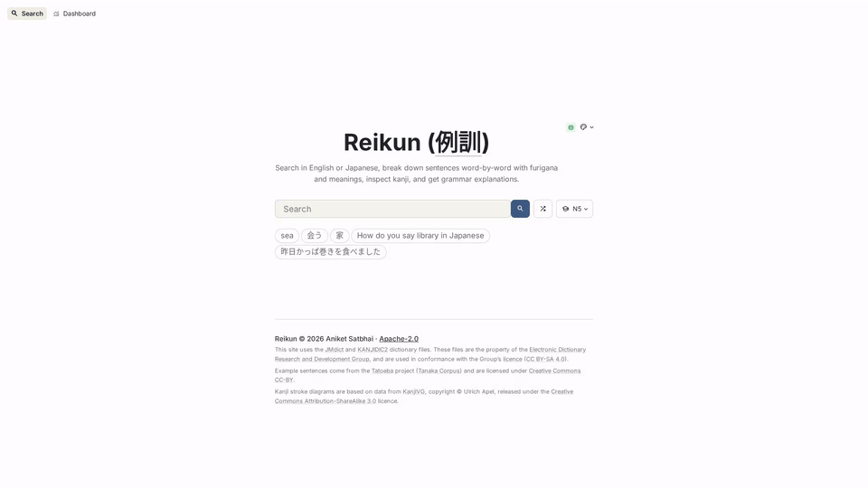

<p align="center">
  <a href="https://reikun.app/">
    <picture>
      <source media="(prefers-color-scheme: dark)" srcset="assets/icons/icon-dark.svg">
      <source media="(prefers-color-scheme: light)" srcset="assets/icons/icon-light.svg">
      
    </picture>
  </a>
</p>

<h1 align="center">Reikun (例訓) — Semantic Japanese Dictionary</h1>

<p align="center">
  A Japanese reading assistant — search in English or Japanese, break down sentences word-by-word with furigana and meanings, inspect kanji, and get grammar explanations tuned to your JLPT level.
</p>

<p align="center">
  <a href="https://github.com/AnkS4/Reikun/releases">
    
  </a>
  <a href="https://github.com/AnkS4/Reikun/blob/main/LICENSE">
    
  </a>
  <a href="https://reikun.app/">
    
  </a>
  <a href="https://github.com/AnkS4/Reikun/blob/main/CHANGELOG.md">
    
  </a>
</p>

## Demo



## Features

- **Hybrid Search with query routing**: Dense vector embeddings (FastEmbed) + BM25 sparse vectors fused server-side in Qdrant (RRF). `mode=auto` routes the query: Japanese → BM25 + exact match, English word → hybrid + commonness prior, English sentence → dense-weighted fusion.
- **Query Rewriting**: Natural-language questions ("how do you say hospital") are normalised to dictionary glosses before retrieval — free regex heuristics by default, optional Groq LLM rewriting for descriptive queries
- **Sentence Breakdown**: Paste Japanese text and Sudachi splits it into word units — furigana on top, gloss underneath, full breakdown on hover. Inflection tails merge into single chips and adjacent segments re-resolve into JMdict compounds
- **Kanji Lookup**: Deterministic kanji information (no LLM) — stroke-order diagrams (KanjiVG), readings, meanings, and common compound words
- **Grammar Explanations**: AI-generated grammar explanations calibrated to your JLPT level (N5–N1) via Groq, on demand only, with a smaller fallback model if the primary is exhausted
- **Feedback & Telemetry**: Thumbs-up/down feedback and query telemetry as JSON events (stdout sink, picked up by platform logs) or a local SQLite file; search queries are logged verbatim (feedback/explanation text stays SHA-256-only) and rows are kept indefinitely
- **Interface**: Search-first landing page, furigana (`<ruby>`) headwords, animated stroke order, light/dark themes, shareable URLs (`?q=猫&level=N3`), one-click level-aware grammar explanations
- **HTTP API**: FastAPI layer (`app/api.py`) over the same pipeline — standalone uvicorn service with routes at the root (what the Docker image serves); includes SSE streaming for explanations and JSON-shaped rendering (ruby parts, kanji card, segment chips, stroke data) for the web frontend

## Tech Stack

- **Frontend**: SvelteKit static SPA (`web/`, adapter-static); Inter + Noto Sans JP web fonts
- **API**: FastAPI + Uvicorn (the production serving process; one worker)
- **Vector Database**: Qdrant (named dense + sparse vectors, server-side RRF hybrid)
- **Embeddings**: FastEmbed — `all-MiniLM-L6-v2` (dense, 384-dim) + `Qdrant/bm25` (sparse), ONNX-quantized for CPU
- **LLM**: Groq `openai/gpt-oss-120b` (→ `gpt-oss-20b` fallback) — grammar explanations, optional query rewriting, LLM-judged evals (all token-budgeted)
- **Ingestion pipeline**: `scripts/startup.py` can run wait-for-Qdrant → check-state → download → build → ingest with retries, then launch the app — opt-in via `INGEST_VIA_DOCKER=1` or `--ingest` (off by default; `--ingest-only` runs it without launching the API server). Populated collections get an incremental top-up instead — rsync delta + upsert of new/edited entries only
- **Monitoring**: JSON event telemetry (`app/telemetry.py`; optional SQLite sink in `scripts/feedback_log.py`)
- **Data Sources**: JMdict, KANJIDIC2, Tatoeba Corpus, KanjiVG
- **Containerization**: Docker & Docker Compose

## Installation

### Prerequisites

- **Docker and Docker Compose** (recommended path — runs the app + Qdrant)
- **Groq API key** — powers grammar explanations and optional LLM query rewriting; search and kanji lookup work without it
- **Git** (to clone) and ~3 GB free disk (dictionary data + embedding models)
- Local development only: **Python 3.14+** and **[uv](https://docs.astral.sh/uv/)** (dependency manager — `pip` works too)

### Setup

1. **Clone the repository**:
   ```bash
   git clone https://github.com/AnkS4/Reikun
   cd Reikun
   ```

2. **Set up environment variables**:
   ```bash
   cp .env.example .env
   # Edit .env and add your GROQ_API_KEY
   ```

### Running the Application

#### Option 1: Docker (Recommended)

First run — let the containers self-provision and ingest all ~219k entries at boot (embedding takes ~1 hr):

```bash
INGEST_VIA_DOCKER=1 docker compose up -d --build
```

(or set `INGEST_VIA_DOCKER=1` in `.env` for the same effect on every `docker compose up --build`)

Once Qdrant is populated, plain `up` serves whatever it already holds:

```bash
docker compose up -d        # API at http://localhost:8000, frontend at http://localhost:5173
docker compose logs -f app  # follow API logs
docker compose down
```

Both the API (`app`) and frontend (`web`) run in Docker. The web container connects to the API via `http://app:8000` internally.

#### Option 2: Local Development

For local development without Docker:

1. **Install Python dependencies** (creates `.venv` and installs locked deps):
   ```bash
   uv sync
   ```

2. **Download and process data**:
   ```bash
   uv run python scripts/download_edrdg.py    # JMdict NG + KANJIDIC2 XML from EDRDG (needs rsync)
   uv run python scripts/download_kanjivg.py  # KanjiVG stroke-order SVGs
   uv run python scripts/build_chunks.py      # parse + chunk → data/processed/
   ```

3. **Start Qdrant**:
   ```bash
   docker compose up -d qdrant
   ```

4. **Ingest data into Qdrant** (~219k entries; `--common` loads a ~37k quick-test subset; cached in `data/`):
   ```bash
   QDRANT_HOST=localhost uv run python scripts/ingest.py
   ```

5. **Run the HTTP API** — the same FastAPI app the Docker image serves (`app/api.py`, routes at the root):
   ```bash
   uv run uvicorn app.api:app --reload          # Swagger UI at http://localhost:8000/docs
   ```

6. **Run the SvelteKit web frontend** (`web/` — needs the API running from step 5):
   ```bash
   cd web && npm install && npm run dev     # dev server → http://localhost:5173
   npm run check                            # svelte-check type diagnostics
   npm run build                            # static build → web/build/ (adapter-static)
   ```

   Note: The build script automatically syncs brand assets from `assets/` to `web/static/`. To manually sync assets, run `bash scripts/sync-assets.sh` from the project root.

   The API base URL is baked in at build time via `PUBLIC_API_BASE` (default `http://localhost:8000`; schema in `web/src/env.ts`, see `web/.env.example`). The static output deploys to any static host as-is.

7. **(Optional) Lint + tests** (CI runs the same — `.github/workflows/ci.yml`):
   ```bash
   uv run ruff check .
   uv run pytest -q                        # API + telemetry tests; no Qdrant needed
   ```

### URL parameters

The Search page keeps its state in the URL, so results are shareable and the browser back button works:

| Param | Example | Meaning |
|---|---|---|
| `q` | `?q=食べる` | Runs the search on load |
| `level` | `?level=N3` | JLPT level used for grammar explanations (remembered until changed) |
| `kanji` | `?kanji=猫` | Legacy deep link — redirects to a single-kanji `?q=` search |

## Project Structure

<!-- Concise overview — full breakdown in local/notes/Architecture.md -->
```
Reikun/
├── app/         # FastAPI backend (search, kanji, grammar, embeddings)
├── web/         # SvelteKit static SPA frontend
├── assets/      # Brand assets (favicons, icons, OG images)
├── docs/        # API spec, screenshots, demo videos
├── eval/        # Gold set, benchmarks, reports
├── scripts/     # Data download/build/ingest utilities
├── data/        # Raw/processed dictionary data, stroke SVGs
├── models/      # Cached embedding models
├── Dockerfile
└── docker-compose.yml
```

## Environment Variables

Create a `.env` file (see `.env.example`):

- `APP_PORT`: Port the API container is published on (default: 8000)
- `GROQ_API_KEY`: Required for grammar explanations (get at https://console.groq.com/keys)
- `LLM_MODEL` / `LLM_MODEL_FALLBACK`: Groq chat models — primary and failover (defaults: `openai/gpt-oss-120b` / `openai/gpt-oss-20b`)
- `QDRANT_HOST` / `QDRANT_PORT`: Qdrant connection (defaults: localhost / 6333); `QDRANT_URL` + `QDRANT_API_KEY` override for Qdrant Cloud
- `QDRANT_COLLECTION`: Qdrant collection name (default: jmdict_chunks)
- `EMBED_MODEL`: Dense embedding model (default: `sentence-transformers/all-MiniLM-L6-v2`)
- `QUERY_REWRITE`: `heuristic` (default, free), `auto` (adds one Groq call for long English queries — best MRR but uses free-tier quota), or `off`

See [docs/configuration.md](docs/configuration.md) for deployment notes, Groq free-tier details, and port configuration.

## Evaluation

Category-wise results on the gold set (360 queries, 60 per category) — default config (`mode=auto`, heuristic rewrite) against a local collection of 218,786 points:

| subset | n | Hit@1 | Hit@2 | Hit@5 |
|---|---|---|---|---|
| en_verbs | 60 | 58 (96.7%) | 59 | 60 |
| en_words | 60 | 56 (93.3%) | 59 | 60 |
| ja_hiragana | 60 | 58 (96.7%) | 60 | 60 |
| ja_katakana | 60 | 60 (100.0%) | 60 | 60 |
| ja_words | 60 | 60 (100.0%) | 60 | 60 |
| **ranking total** | **300** | **292 (97.3%)** | **298** | **300** |
| en_descriptive (paraphrase suite) | 60 | 9 (15.0%) | 13 | 22 |

Hit@1 **97.3%** over the 300 ranking queries, Hit@5 **300/300**, median ~15 ms per query; the Japanese exact-lookup route is at Hit@1 100%. The eight ranking misses are synonym ambiguities (金/お金, 時/時間, 表/テーブル, 文庫/図書館, 仕舞う/終わる, …) — every one has a valid answer in the top 5.

Full report: [eval/reports/headword_eval.md](eval/reports/headword_eval.md) · benchmark scripts, metrics and the other reports: [eval/reports/eval.md](eval/reports/eval.md)

## Data Sources

- **JMdict**: Japanese-English dictionary data © Jim Breen & EDRDG (CC BY-SA 4.0)
- **KANJIDIC2**: Kanji dictionary data © Jim Breen & EDRDG (CC BY-SA 4.0)
- **Tanaka Corpus / Tatoeba**: Example sentences (CC BY 2.0 FR)
- **KanjiVG**: Kanji stroke order diagrams © Ulrich Apel (CC BY-SA 3.0)

## License

Code is licensed under [Apache-2.0](LICENSE). Dictionary data remains under its
source licenses (see [NOTICE](NOTICE)) — derived files under `data/` are
share-alike per CC BY-SA.
