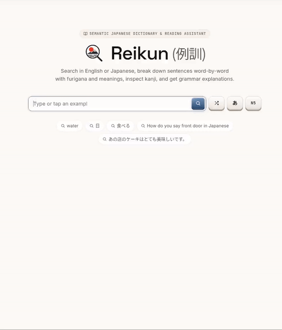

<p align="center">
  <a href="https://reikun.app/">
    
  </a>
</p>

<h1 align="center">Reikun (例訓) — Semantic Japanese Dictionary & Reading Assistant</h1>

<p align="center">
  A Semantic Japanese Dictionary & Reading Assistant — search in English or Japanese, break down sentences word-by-word with furigana and meanings, inspect kanji, and get grammar explanations tuned to your JLPT level.
</p>

<p align="center">
  <a href="https://github.com/AnkS4/Reikun/releases">
    
  </a>
  <a href="https://github.com/AnkS4/Reikun/blob/main/LICENSE">
    
  </a>
  <a href="https://reikun.app/">
    
  </a>
  <a href="https://github.com/AnkS4/Reikun/blob/main/CHANGELOG.md">
    
  </a>
</p>

## Demo



## Features

- **Hybrid Search with query routing**: Dense + BM25 sparse vectors fused server-side in Qdrant (RRF). `mode=auto` routes the query: Japanese → BM25 + exact match, English word → hybrid + commonness prior, English sentence → dense-weighted fusion.
- **Query Rewriting**: Natural-language questions ("how do you say hospital") are normalised to dictionary glosses before retrieval — regex heuristics handle common question forms, and the shipped `QUERY_REWRITE=auto` config adds LLM pivoting to ranked Japanese headwords for descriptive queries
- **Sentence Breakdown**: Paste Japanese text and Sudachi splits it into word units — furigana on top, gloss underneath, full breakdown on hover. Inflection tails merge into single chips and adjacent segments re-resolve into JMdict compounds
- **Kanji Lookup**: Deterministic kanji information (no LLM) — stroke-order diagrams (KanjiVG), readings, meanings, and common compound words
- **Grammar Explanations**: AI-generated explanations calibrated to your JLPT level (N5–N1) via a configurable LLM provider, on demand only, with a smaller fallback model if the primary is exhausted
- **Feedback & Telemetry**: Thumbs-up/down feedback and query telemetry as JSON events (stdout sink, picked up by platform logs) or a local SQLite file; search queries are logged verbatim (feedback/explanation text stays SHA-256-only) and rows are kept indefinitely
- **Interface**: Search-first landing page, furigana (`<ruby>`) headwords, animated stroke order, light/dark themes, English/Japanese UI chrome, shareable URLs (`?q=猫&level=N3`), one-click level-aware grammar explanations
- **HTTP API**: FastAPI layer (`app/api.py`) over the same pipeline — SSE streaming for explanations and JSON-shaped rendering (ruby parts, kanji card, segment chips, stroke data) for the web frontend

## Tech Stack

- **Frontend**: SvelteKit static SPA (`web/`, adapter-static); Inter + Noto Sans JP web fonts
- **API**: FastAPI + Uvicorn (the production serving process; one worker)
- **Vector Database**: Qdrant (named dense + sparse vectors, server-side RRF hybrid)
- **Embeddings**: FastEmbed — `all-MiniLM-L6-v2` (dense, 384-dim) + `Qdrant/bm25` (sparse), ONNX-quantized for CPU
- **LLM**: Nebius (Nemotron-3_5-Lightning, default), Groq, Gemini, or Cohere via `LLM_PROVIDER` — powers grammar explanations, optional query rewriting, and LLM-judged evals (token-budgeted)
- **Telemetry**: JSON events (`app/telemetry.py`); optional SQLite sink (`scripts/feedback_log.py`)
- **Containerization**: Docker & Docker Compose

## Installation

### Prerequisites

- **Docker and Docker Compose** (recommended path — runs the app + Qdrant)
- **LLM API key** — powers grammar explanations and optional query rewriting (see `docs/configuration.md` for provider options); search and kanji lookup work without it when `QUERY_REWRITE=heuristic` or `off`
- **Git** (to clone) and ~3 GB free disk (dictionary data + embedding models)
- Local development only: **Python 3.14+** and **[uv](https://docs.astral.sh/uv/)** (dependency manager — `pip` works too)

### Setup

1. **Clone the repository**:
   ```bash
   git clone https://github.com/AnkS4/Reikun
   cd Reikun
   ```

2. **Set up environment variables**:
   ```bash
   cp .env.example .env
   # Edit .env: see docs/configuration.md for all options
   ```

### Running the Application

#### Option 1: Docker (Recommended)

First run — pass `INGEST_VIA_DOCKER=1` on the compose command so the API container downloads, builds, and ingests all ~219k entries at boot (embedding takes ~1 hr). `scripts/startup.py` handles this: wait for Qdrant → check state → download → build → ingest with retries, then launch the app (also exposed as `--ingest`; `--ingest-only` runs just the pipeline). Plain `up` never ingests; do not put this flag in `.env`.

```bash
INGEST_VIA_DOCKER=1 docker compose up -d --build
```

Once Qdrant is populated, omit the flag so the same stack just serves — repeat startups only top up the collection (rsync delta of new/edited entries):

```bash
docker compose up -d        # API at http://localhost:8000, frontend at http://localhost:5173
docker compose logs -f app  # follow API logs
docker compose down
```

Both the API (`app`) and frontend (`web`) run in Docker; the static bundle the web container serves is baked with the API base `http://127.0.0.1:${APP_PORT:-8000}` (the app service's published loopback port — Docker-network hostnames like `app` only resolve inside the Compose network, never from the host browser).

#### Option 2: Local Development

For local development without Docker:

1. **Install Python dependencies** (creates `.venv` and installs locked deps):
   ```bash
   uv sync
   ```

2. **Download and process data**:
   ```bash
   uv run python scripts/download_edrdg.py    # JMdict NG + KANJIDIC2 XML from EDRDG (needs rsync)
   uv run python scripts/download_kanjivg.py  # KanjiVG stroke-order SVGs
   uv run python scripts/build_chunks.py      # parse + chunk → data/processed/
   ```

3. **Start Qdrant**:
   ```bash
   docker compose up -d qdrant
   ```

4. **Ingest data into Qdrant** (~219k entries; `--common` loads a ~37k quick-test subset; cached in `data/`):
   ```bash
   QDRANT_HOST=localhost uv run python scripts/ingest.py
   ```

5. **Run the HTTP API** — the same app the Docker image serves (`app/api.py`, routes at the root):
   ```bash
   uv run uvicorn app.api:app --reload          # Swagger UI at http://localhost:8000/docs
   ```

6. **Run the SvelteKit web frontend** (`web/` — needs the API running from step 5):
   ```bash
   cd web && npm ci && npm run dev          # dev server → http://localhost:5173
   npm run check                            # svelte-check type diagnostics
   npm run build                            # static build → web/build/ (adapter-static)
   ```

   Note: the build auto-syncs brand assets from `assets/` to `web/static/` (`bash scripts/sync-assets.sh` to sync them manually). The API base URL is baked in at build time via `PUBLIC_API_BASE` (default `http://localhost:8000`; schema in `web/src/env.ts`, see `web/.env.example`), and the static output deploys to any static host as-is.

7. **(Optional) Lint + tests** (CI runs the same — `.github/workflows/ci.yml`):
   ```bash
   uv run ruff check .
   uv run pytest -q                        # API + telemetry tests; no Qdrant needed
   ```

### URL parameters

Search state lives in the URL, so results are shareable and the browser back button works:

| Param | Example | Meaning |
|---|---|---|
| `q` | `?q=食べる` | Runs the search on load |
| `level` | `?level=N3` | JLPT level used for grammar explanations (remembered until changed) |
| `kanji` | `?kanji=猫` | Legacy deep link — redirects to a single-kanji `?q=` search |

## Project Structure

<!-- Concise overview of the full structure; see the docs/ and eval/ trees -->
```
Reikun/
├── app/         # FastAPI backend (search, kanji, grammar, embeddings)
├── web/         # SvelteKit static SPA frontend
├── assets/      # Brand assets (favicons, icons, OG images)
├── docs/        # API spec, screenshots, demo videos
├── eval/        # Gold set, benchmarks, reports
├── scripts/     # Data download/build/ingest utilities
├── data/        # Raw/processed dictionary data, stroke SVGs
├── models/      # Cached embedding models
├── Dockerfile
└── docker-compose.yml
```

## Momentum Guide: Nebius & NVIDIA

Reikun is built for the [Nebius × NVIDIA Global AI Hackathon](https://nebiusglobalaihackathon.devpost.com).

- **Nebius Token Factory** is the default LLM provider (`LLM_PROVIDER=nebius`, `nvidia/Nemotron-3_5-Lightning`) — a runtime call to the Token Factory API powers the one-click, JLPT-calibrated grammar explanations and the Japanese-pivot query rewriting.
- **NVIDIA Nemotron** scores 93.3% Hit@1 on descriptive queries (see [Evaluation](#evaluation)) while reasoning-free inference keeps warm calls under 1s after `chat_template_kwargs: {"enable_thinking": false}` tuned Nemotron's default reasoning off for a latency-sensitive UX.
- Groq/Gemini/Cohere remain one-env-var alternatives, but the shipped default — and the production instance at reikun.app — is Nebius + Nemotron.

## Evaluation

360-query gold set: 300 ranking + 60 descriptive. The table uses the 218,786-point local collection, `mode=auto`, and default retrieval settings. Methodology: [eval/reports/eval.md](eval/reports/eval.md).

### Ranking queries (300)

Default config (`QUERY_REWRITE=auto`):

| subset | n | Hit@1 | Hit@2 | Hit@5 |
|---|---|---|---|---|
| en_verbs | 60 | 58 (96.7%) | 59 | 60 |
| en_words | 60 | 56 (93.3%) | 59 | 60 |
| ja_hiragana | 60 | 58 (96.7%) | 60 | 60 |
| ja_katakana | 60 | 60 (100.0%) | 60 | 60 |
| ja_words | 60 | 60 (100.0%) | 60 | 60 |
| **ranking total** | **300** | **292 (97.3%)** | **298** | **300** |

All 300 queries have a valid answer in the top 5; median ~15 ms per query. Per-query misses: [headword report](eval/reports/headword_eval.md).

### Descriptive queries (60)

Every model in the shipped provider defaults, plus the two retired Nebius predecessors (`*`), tested under the current Japanese-pivot rewrite (`QUERY_REWRITE=auto`), sorted by Hit@1, then Hit@2/Hit@5:

| provider | model | Hit@1 | Hit@2 | Hit@5 |
|---|---|---|---|---|
| Groq | `openai/gpt-oss-120b` | 57 (95.0%) | 57 | 57 |
| Nebius | `nvidia/Nemotron-3_5-Lightning` | 56 (93.3%) | 56 | 56 |
| Nebius* | `nvidia/NVIDIA-Nemotron-3-Nano-30B-A3B` | 56 (93.3%) | 56 | 56 |
| Nebius | `nvidia/Nemotron-3.5-Super-VL` | 55 (91.7%) | 55 | 55 |
| Nebius* | `nvidia/nemotron-3-super-120b-a12b` | 54 (90.0%) | 54 | 54 |
| Cohere | `command-r-plus-08-2024` | 53 (88.3%) | 53 | 54 |
| Cohere | `command-a-plus-05-2026` | 49 (81.7%) | 51 | 52 |
| Gemini | `gemini-3.5-flash-lite` | 46 (76.7%) | 46 | 48 |
| Groq | `openai/gpt-oss-20b` | 21 (35.0%) | 26 | 33 |

*Deprecated by Nebius Token Factory (Nov 9, 2026); migrated to non-deprecated replacements (Nemotron-3_5-Lightning, Nemotron-3.5-Super-VL).

Single-run scores; one-query gaps are within the paraphrase suite's ±1 jitter. Per-model details: [descriptive_models.md](eval/reports/descriptive_models.md).

## Data Sources

- **JMdict**: Japanese-English dictionary data © Jim Breen & EDRDG (CC BY-SA 4.0)
- **KANJIDIC2**: Kanji dictionary data © Jim Breen & EDRDG (CC BY-SA 4.0)
- **Tanaka Corpus / Tatoeba**: Example sentences (CC BY 2.0 FR)
- **KanjiVG**: Kanji stroke order diagrams © Ulrich Apel (CC BY-SA 3.0)

## License

Code is licensed under [Apache-2.0](LICENSE). Dictionary data remains under its
source licenses (see [NOTICE](NOTICE)) — derived files under `data/` are
share-alike per CC BY-SA.
